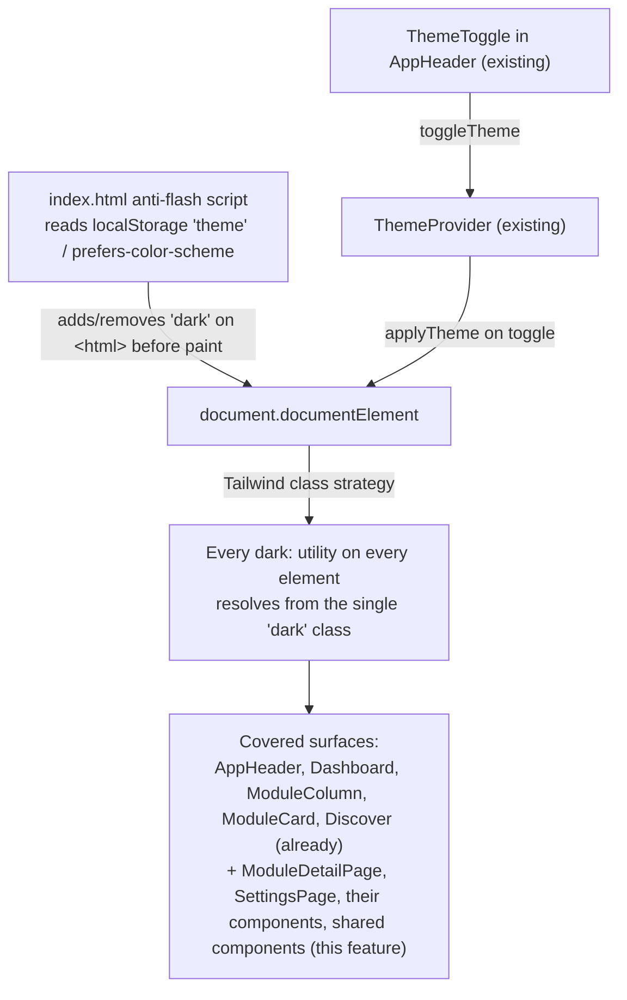

# Design Document

## Overview

This feature closes the dark-mode coverage gap on the surfaces that were built
before the theme was introduced: the Module Detail page, the Settings page, and
all of the components they render, plus the remaining shared components
(dialogs, modals, badges, form controls, the install banner). It is a **pure
styling effort** — no new theme state, toggle, persistence, or runtime theme
logic is introduced. The entire change is adding Tailwind `dark:` variant
utility classes to existing elements.

The theme mechanism already exists and is reused as-is:

- `src/theme/theme.ts` — `getInitialTheme()` / `applyTheme()`, the `'theme'`
  localStorage key, and the `prefers-color-scheme` fallback.
- `src/theme/ThemeContext.tsx` — `ThemeProvider` + `useTheme`.
- `src/components/ThemeToggle.tsx` — the single toggle, rendered inside
  `AppHeader`.
- Tailwind configured with `darkMode: 'class'`.
- The inline anti-flash script in `index.html` that adds the `dark` class to
  `<html>` before React mounts.
- `App.tsx`'s shell root, which already carries
  `dark:bg-gray-900 dark:text-gray-100`.

Because Tailwind's `class` strategy keys every `dark:` utility off the presence
of the `dark` class on `document.documentElement`, adding `dark:` variants to a
component is sufficient for it to respond to the already-wired toggle. No
component needs to read the theme in JavaScript.

The reference surfaces already covered — `AppHeader`, `DashboardPage`,
`ModuleColumn`, `ModuleCard`, `DiscoverSearchPanel` — establish a consistent
dark palette. This design lifts that palette into a single mapping table (the
source of truth) and applies it uniformly to every uncovered surface.

**Requirements coverage:** Overview and Architecture address Requirement 1
(reuse) and Requirement 6 (no flash); the palette table and per-surface plan
address Requirements 2, 3, 4, and 5.

## Architecture

### How the dark class cascades (no new runtime logic)



Key architectural properties:

1. **Single source of truth.** The active theme is represented only by the
   `dark` class on the document root. No component in scope reads `useTheme()`
   or any other theme source to decide styling (Req 1.1, 1.2). `useTheme` stays
   confined to `ThemeToggle`, which is out of scope here.
2. **Declarative styling only.** Theme-specific styling is expressed purely as
   `dark:` variant classes in the `className` string. No component branches on
   the theme in JS to emit class names or inline styles for theming purposes
   (Req 1.2). Existing non-theme conditional classes (e.g. error vs. normal
   input states) are retained and simply get `dark:` variants added to each
   branch.
3. **No new mechanism.** This feature adds zero state, zero storage keys, zero
   effects, and zero toggles. The one toggle in `AppHeader` remains the only
   theme control (Req 1.3, 1.4).
4. **No flash, for free.** Because the anti-flash script sets the `dark` class
   before first paint and `dark:` variants are plain CSS that apply on first
   paint, every newly-covered surface renders in the correct theme in its first
   painted frame, including after client-side navigation to Module Detail or
   Settings (Req 6.1, 6.2). A toggle flips one class on the root, so all mounted
   surfaces switch together in the same frame — there is never a frame where one
   covered surface shows one theme and another shows the opposite (Req 6.3,
   6.4).

### Change surface

All edits are additive `className` changes in existing `.tsx` files under
`src/pages` and `src/components`. No `.ts`/logic files, no config, and no theme
infrastructure files change.

## Components and Interfaces

There are no new components, props, or interfaces. The "interface" of this
feature is the **dark palette mapping convention** (below), which every edited
file must follow so that a given semantic element looks identical wherever it
appears (Req 3.2).

### Dark palette mapping (single source of truth)

Every uncovered light-only class in scope maps to a fixed `dark:` variant. When
editing a file, find the light class in the left column and add the `dark:`
variant from the right column alongside it (never replace the light class — the
light appearance must be preserved exactly, Req 2.6).

#### Surfaces and containers

| Light class | Add dark variant | Role |
|---|---|---|
| `bg-white` | `dark:bg-gray-800` | card / panel / modal / input surface |
| `bg-gray-50` | `dark:bg-gray-900` | page background, subtle section fill |
| `bg-gray-50` (header strip in accordion) | `dark:bg-gray-800` | nested header strip on a card |
| `bg-gray-100` (skeleton block) | `dark:bg-gray-700` | loading skeleton placeholder |
| `bg-gray-200` (skeleton block) | `dark:bg-gray-700` | loading skeleton placeholder (larger) |
| `bg-black/50` (modal backdrop) | *(unchanged)* | backdrop already theme-neutral |

#### Borders and dividers

| Light class | Add dark variant | Role |
|---|---|---|
| `border-gray-200` | `dark:border-gray-700` | card / list / divider border |
| `border-gray-300` | `dark:border-gray-600` | input / secondary-button border |
| `border-gray-100` | `dark:border-gray-700` | subtle inner divider |
| `divide-gray-100` | `dark:divide-gray-700` | list row dividers |
| `divide-gray-200` | `dark:divide-gray-700` | list row dividers |

#### Text

| Light class | Add dark variant | Role |
|---|---|---|
| `text-gray-900` | `dark:text-gray-100` | primary text / headings |
| `text-gray-800` | `dark:text-gray-100` | strong body text |
| `text-gray-700` | `dark:text-gray-200` | labels, secondary-button text |
| `text-gray-600` | `dark:text-gray-300` | secondary text, muted controls |
| `text-gray-500` | `dark:text-gray-400` | tertiary / help text |
| `text-gray-400` | `dark:text-gray-500` | empty-state / placeholder-adjacent text, faint icons |
| `text-gray-300` (large decorative icon) | `dark:text-gray-600` | not-found / empty illustration |

#### Form inputs

| Light class | Add dark variant | Role |
|---|---|---|
| input `bg-white` | `dark:bg-gray-900` | input surface (darker than card for contrast) |
| input `text-gray-900` / default text | `dark:text-gray-100` | typed text |
| `placeholder-gray-400` | `dark:placeholder-gray-500` | placeholder text |
| input `border-gray-300` | `dark:border-gray-600` | input border |
| `hover:border-gray-400` | `dark:hover:border-gray-500` | input hover border |
| `bg-gray-100 text-gray-400` (disabled input, TagInput) | `dark:bg-gray-800 dark:text-gray-500 dark:border-gray-700` | disabled input |
| `textarea`/`MarkdownEditor` `border-gray-300` + default bg | `dark:border-gray-600 dark:bg-gray-900 dark:text-gray-100 dark:placeholder-gray-500` | markdown textarea |

Focus rings stay `focus:ring-indigo-500` in both themes; where a ring offset is
used (`focus:ring-offset-1` / `focus:ring-offset-2`) on a dark surface, add
`dark:focus:ring-offset-gray-900` (or `-gray-800` when the adjacent surface is a
card) so the offset ring stays visible (Req 5.3, 5.4). The indigo-500 ring on a
`gray-800`/`gray-900` surface exceeds 3:1, satisfying Req 5.3.

#### Buttons

| Light pattern | Add dark variant | Role |
|---|---|---|
| primary `bg-indigo-600 text-white hover:bg-indigo-700` | *(unchanged)* | indigo-600 on dark already meets AA for white text; keep as-is |
| secondary `bg-white text-gray-700 border-gray-300 hover:bg-gray-50` | `dark:bg-gray-800 dark:text-gray-200 dark:border-gray-600 dark:hover:bg-gray-700` | Cancel / secondary action |
| ghost `text-gray-600 hover:text-gray-900 hover:bg-gray-100` | `dark:text-gray-300 dark:hover:text-gray-100 dark:hover:bg-gray-800` | icon / text-only control |
| ghost danger `text-gray-400 hover:text-red-600 hover:bg-red-50` | `dark:text-gray-500 dark:hover:text-red-400 dark:hover:bg-red-900/40` | delete icon button |
| text link `text-indigo-600 hover:text-indigo-800` | `dark:text-indigo-400 dark:hover:text-indigo-300` | external/content links |
| destructive `bg-red-600 text-white hover:bg-red-700` | *(unchanged)* | destructive confirm; add `dark:focus:ring-offset-gray-800` for the offset |

#### Badges, pills, and status chips

| Light pattern | Add dark variant | Role |
|---|---|---|
| tag `bg-blue-100 text-blue-800` | `dark:bg-blue-900 dark:text-blue-200` | TagBadge |
| tag remove `text-blue-600 hover:text-blue-900` | `dark:text-blue-300 dark:hover:text-blue-100` | TagBadge × |
| status set `text-green-700 bg-green-50 border-green-200` | `dark:text-green-300 dark:bg-green-900/40 dark:border-green-800` | "Set" chip |
| status dot `bg-green-500` | *(unchanged)* | colored dot reads in both themes |
| status not-set `text-gray-500 bg-gray-50 border-gray-200` | `dark:text-gray-400 dark:bg-gray-800 dark:border-gray-700` | "Not set" chip |
| status dot `bg-gray-400` | `dark:bg-gray-500` | not-set dot |
| quality star filled `text-yellow-400` | *(unchanged)* | reads on dark |
| quality star empty `text-gray-300` | `dark:text-gray-600` | unfilled star |

#### Error / alert and success boxes

| Light pattern | Add dark variant | Role |
|---|---|---|
| error `bg-red-50 border-red-200 text-red-700` | `dark:bg-red-900/30 dark:border-red-800 dark:text-red-300` | inline error / alert box |
| error input `border-red-400 bg-red-50 text-red-800` | `dark:border-red-700 dark:bg-red-950/40 dark:text-red-200` | invalid input state |
| error helper `text-red-600` | `dark:text-red-400` | field error message |
| warning `bg-amber-50 border-amber-200 text-amber-800` | `dark:bg-amber-900/30 dark:border-amber-800 dark:text-amber-200` | non-blocking notice (reference parity) |
| success `text-green-700 bg-green-50 border-green-200` | `dark:text-green-300 dark:bg-green-900/30 dark:border-green-800` | success banner |
| progress `text-indigo-700 bg-indigo-50 border-indigo-200` | `dark:text-indigo-300 dark:bg-indigo-900/30 dark:border-indigo-800` | in-flight status (DriveControls) |

The error accent (red family) stays distinct from non-error surfaces
(gray/indigo) on the same page in dark mode, satisfying Req 3.4.

### Per-surface styling plan

Each entry lists the file and the specific light-only elements to give `dark:`
variants, using the mapping table above. The requirement each entry satisfies is
annotated.

#### Pages

**`src/pages/ModuleDetailPage.tsx`** (Req 2.1)
- Outer wrapper `bg-gray-50` → add `dark:bg-gray-900`.
- `LoadingState` skeleton blocks `bg-gray-100` / `bg-gray-200` → add
  `dark:bg-gray-700` (Req 3.5 — 1.5:1 against `gray-900` is met).
- `NotFoundState`: heading `text-gray-700` → `dark:text-gray-200`; body
  `text-gray-500` → `dark:text-gray-400`; svg `text-gray-300` →
  `dark:text-gray-600`.
- Collapse/Expand buttons `text-gray-600 hover:text-gray-900` →
  `dark:text-gray-300 dark:hover:text-gray-100`.
- Empty-section message `text-gray-400` → `dark:text-gray-500`.
- Inline delete-error box `border-red-200 bg-red-50 text-red-700` →
  `dark:border-red-800 dark:bg-red-900/30 dark:text-red-300`.
- Inline `ConfirmDialog` message `<strong class="text-gray-900">` →
  `dark:text-gray-100`.

**`src/pages/SettingsPage.tsx`** (Req 2.2)
- Outer wrapper `bg-gray-50` → `dark:bg-gray-900`.
- `h1 text-gray-900` → `dark:text-gray-100`.
- Each of the three section cards `border-gray-200 bg-white` →
  `dark:border-gray-700 dark:bg-gray-800`.
- Each card `h2 text-gray-900` → `dark:text-gray-100`.

#### Detail components (Req 2.3)

**`src/components/ModuleHeader.tsx`** — Back/Delete controls' gray text; edit
input (`text-gray-900` / `border-indigo-400` branch and the `border-red-400
text-red-800` error branch); "Press Enter…" hint `text-gray-400`; module title
`text-gray-900`; chevron/edit icon `text-gray-400`; Tags label `text-gray-700`;
field error `text-red-600`.

**`src/components/SectionAccordion.tsx`** — card `border-gray-200`; header strip
`bg-gray-50`; toggle `hover:bg-gray-100`; title `text-gray-900`; progress
summary `text-gray-500`; chevron `text-gray-400`; rename input (normal +
`border-red-400 bg-red-50 text-red-800` error branch); Save (primary, keep) /
Cancel (secondary) buttons; action icon buttons (ghost + ghost-danger); inline
delete-error strip `bg-red-50 border-red-200 text-red-700`; `ConfirmDialog`
`<strong>`.

**`src/components/AddSectionForm.tsx`** — DB-error banner; input (normal +
error branch); field error `text-red-600`; Add button (primary, keep; add
`dark:focus:ring-offset-gray-900`).

**`src/components/SectionContent.tsx`** — "Loading…" / "No content items yet."
`text-gray-400`; "Search the web" disclosure link (indigo link treatment +
`hover:bg-indigo-50` → `dark:hover:bg-indigo-900/40`).

**`src/components/ContentItemRow.tsx`** — row dividers `border-gray-200`; row
hover `hover:bg-gray-50` → `dark:hover:bg-gray-800`; title link
`text-indigo-600 hover:text-indigo-800`; external-link icon `text-gray-400`;
edit/delete icon buttons (ghost + ghost-danger incl. `hover:bg-indigo-50` /
`hover:bg-red-50`); metadata `text-gray-500`; all edit-mode inputs (title, URL,
rating — normal + error branches); edit-mode DB-error box; field errors;
Save/Cancel buttons; `ConfirmDialog` `<strong>`.

**`src/components/AddContentItemForm.tsx`** — DB-error box; Title/URL labels
`text-gray-700`; both inputs (normal + error branches); field errors; Add
button (primary).

**`src/components/ContentItemNote.tsx`** — Notes toggle `text-gray-600
hover:text-indigo-700 hover:bg-gray-100` → `dark:text-gray-300
dark:hover:text-indigo-300 dark:hover:bg-gray-800`; error `text-red-600`.

**`src/components/MarkdownEditor.tsx`** (rendered inside notes) — wrapper
`border-gray-200`; tablist border; `ACTIVE_TAB_STYLE` (`bg-white
text-indigo-700 border-indigo-500` → `dark:bg-gray-800 dark:text-indigo-300`)
and `INACTIVE_TAB_STYLE` (`bg-gray-50 text-gray-600 hover:bg-gray-100` →
`dark:bg-gray-900 dark:text-gray-400 dark:hover:bg-gray-800`); textarea
(`border-gray-300` + bg + text + placeholder); footer border; char counter
`text-gray-500`; Save button (primary).

**`src/components/MarkdownPreview.tsx`** — verify rendered markdown prose colors;
add `dark:text-gray-200` to the prose container and `dark:` variants to any
hard-coded gray text so rendered notes are readable (Req 2.3, 4.1).

**`src/components/TagInput.tsx`** — input (normal, error, and disabled/at-limit
branches); error `text-red-600`; limit hint `text-gray-500`. (Rendered by both
`ModuleHeader` and `CreateModuleModal`.)

**`src/components/TagBadge.tsx`** — `bg-blue-100 text-blue-800` → dark blue chip;
remove × `text-blue-600 hover:text-blue-900` → dark variants (Req 3.7, 4.3).

**`src/components/QualityBadge.tsx`** — empty star `text-gray-300` →
`dark:text-gray-600`.

**`src/components/ContentThumbnail.tsx` / `ProgressControl.tsx` /
`ContentItemProgress.tsx` / `SourceBadge.tsx` / `WebSearchPanel.tsx`** — read and
apply the mapping to any light-only surface/text/border/badge classes they
carry, since they render within Detail components (Req 2.3). Elements already
theme-neutral (pure colored dots, images) are left unchanged.

#### Settings components (Req 2.4)

**`src/components/ApiKeysSettings.tsx`** — credential label `text-gray-900`;
description `text-gray-500`; password input (`bg-white text-gray-900
border-gray-300`); Save (primary) / Clear (secondary) buttons; confirmation
`text-green-700`; `StatusIndicator` "Set" and "Not set" chips and their dots.

**`src/components/ExportImportSettings.tsx`** — section headings `text-gray-900`;
helper text `text-gray-500` / `text-gray-700`; Export/Import/Confirm/Cancel
buttons (primary + secondary); pending-import panel `border-gray-200 bg-gray-50`
→ `dark:border-gray-700 dark:bg-gray-800`; import-section top border
`border-gray-100`; success and error status boxes.

**`src/components/ModuleSelectList.tsx`** (rendered here) — "no modules"
`text-gray-500`; Select all/none secondary buttons; list `border-gray-200
divide-gray-200`; row `hover:bg-gray-50`; row label `text-gray-800`; checkbox
`border-gray-300` → `dark:border-gray-600 dark:bg-gray-900`.

**`src/components/DriveSettings.tsx`** — thin wrapper, no own styling; covered via
`DriveControls`.

**`src/components/DriveControls.tsx`** — secondary/ghost buttons; progress
(indigo), success (green), error (red) status boxes; nested
`ConfirmRestoreModal` (`bg-white` card, `text-gray-900` heading, `text-gray-600`
body, buttons) — give it the same shared-dialog treatment as `ConfirmDialog`.

#### Shared components (Req 2.5)

**`src/components/ConfirmDialog.tsx`** — card `bg-white` → `dark:bg-gray-800`;
title `text-gray-900`; body `text-gray-600`; Cancel (secondary) button; confirm
button offset ring (`dark:focus:ring-offset-gray-800`). Destructive/indigo fills
are kept.

**`src/components/CreateModuleModal.tsx`** — card `bg-white`; title
`text-gray-900`; close button (ghost); labels `text-gray-700`; required `*`
`text-red-500` (keep), optional hint `text-gray-400`; name input (normal + error
branch); field error; char counter `text-gray-400`; Cancel/Create buttons.

**`src/components/GeneratedModulePreview.tsx`** — panel `border-gray-200
bg-white`; headings `text-gray-900`; helper `text-gray-500` / `text-gray-700`;
name input; name error; section headings and counts; "Select all" labels
`text-gray-600`; checkboxes `border-gray-300`; result dividers `divide-gray-200`;
result links `text-indigo-600`; metadata `text-gray-500`; Save (primary) /
Discard (secondary) buttons; empty-selection error `text-red-600`.

**`src/components/PwaInstallBanner.tsx`** — banner `bg-white border-indigo-200`
→ `dark:bg-gray-800 dark:border-indigo-900`; message `text-gray-800` →
`dark:text-gray-100`; Install (primary) / Dismiss (secondary) buttons; keep the
indigo icon.

## Data Models

This feature introduces no data models, no persisted structures, and no changes
to `src/db` types. The only "model" is the fixed palette mapping documented
above, which lives as a convention in this design document and is realized
directly as Tailwind utility strings in JSX. The existing `Theme = 'light' |
'dark'` type and the `'theme'` localStorage key are reused unchanged and are not
read by any surface in scope.

## Correctness Properties

*A property is a characteristic or behavior that should hold true across all
valid executions of a system — essentially, a formal statement about what the
system should do. Properties serve as the bridge between human-readable
specifications and machine-verifiable correctness guarantees.*

**Scope note for this feature.** This is a CSS-only change using Tailwind's
`class` strategy. The jsdom environment used by the test suite does not apply
Tailwind's generated stylesheet and cannot compute rendered colors, so the
*contrast-ratio* acceptance criteria (4.1, 4.2, 4.3; and the ratios embedded in
2.x/3.x/5.3) are **not** runtime-testable — they are verified at design time
against the fixed palette table and by a manual visual pass (see Testing
Strategy). The *no-flash* criteria (6.1–6.3) depend on the browser paint
pipeline and the existing anti-flash infrastructure, which jsdom cannot exercise;
they are verified manually in a browser. What remains genuinely universal and
mechanically verifiable are the **structural** properties below: they quantify
over the enumerated set of in-scope files/elements and hold for all of them.

The "in-scope files" set is exactly the pages and components listed in the
per-surface styling plan. The "palette mapping" is the table in Components and
Interfaces.

### Property 1: No runtime theme logic

*For all* in-scope component files, the file determines theme-specific styling
only through static `dark:` class literals and contains no runtime
JavaScript theme branching — it does not call `useTheme`, read the `'theme'`
localStorage key, call `matchMedia`, or inspect the document root `dark` class
to conditionally emit class names or inline styles — and it renders no
theme-switching control (no `ThemeToggle` import, no `toggleTheme`/`setTheme`
call).

**Validates: Requirements 1.1, 1.2, 1.3, 1.4, 6.4**

### Property 2: Dark-variant coverage of every UI element category

*For all* in-scope elements that carry a light-only `UI_Element_Category` class
appearing in the palette mapping (surface, border, text, input, button, badge,
skeleton, error/alert, empty-state), the same element also carries the mapped
`dark:` variant class(es) for that light class. Equivalently: for every
(in-scope file, mapped light class) occurrence, its paired `dark:` variant is
present on the same element.

**Validates: Requirements 2.1, 2.2, 2.3, 2.4, 2.5, 3.1, 3.3, 3.6, 3.7**

### Property 3: Consistent dark styling for identical semantic roles

*For all* pairs of elements across in-scope files that share the same semantic
`UI_Element_Category` role (e.g. secondary button, inline error box, tag chip,
card surface, form input), both elements apply the identical set of mapped
`dark:` background, text, and border classes for that role.

**Validates: Requirements 3.2**

### Property 4: Error surfaces stay visually distinct in dark mode

*For all* in-scope error/alert boxes, the element uses the red-family dark
variant classes from the palette mapping (`dark:bg-red-900/30`,
`dark:border-red-800`, `dark:text-red-300`, or the mapped invalid-input
equivalents), and that color family differs from the gray/indigo dark families
used by non-error surfaces on the same page.

**Validates: Requirements 3.4**

### Property 5: Light theme is preserved (additive-only change)

*For all* in-scope elements, every original light-theme class present before
this feature is still present after it, and while the document root does not
carry the `dark` class none of the added `dark:` variants take effect — so each
surface's light appearance is unchanged.

**Validates: Requirements 2.6, 5.2**

### Property 6: Focus indicators are preserved and visible in both themes

*For all* in-scope interactive controls, the control retains its established
focus utilities (`focus:outline-none` together with a `focus:ring-*`
indicator), the dark edit never removes or hides them, and any control that
uses a focus ring offset on a dark surface adds the matching
`dark:focus:ring-offset-gray-900` / `-gray-800` override so the indicator stays
distinguishable from its adjacent background.

**Validates: Requirements 5.1, 5.3, 5.4**

## Error Handling

This feature adds no new runtime code paths, so it introduces no new error
conditions. The relevant resilience already lives in the reused
Theme_Infrastructure and is explicitly out of scope to change:

- **localStorage unavailable** (private mode, disabled storage): both
  `getInitialTheme()` and `applyTheme()` wrap `localStorage` access in
  `try/catch` and fall through gracefully — theme resolution falls back to
  `prefers-color-scheme` then `'light'`, and persistence is silently skipped.
  The anti-flash script in `index.html` mirrors this with its own `try/catch`.
- **matchMedia unavailable** (non-browser / older environments):
  `getInitialTheme()` guards the `matchMedia` call and falls back to `'light'`.
- **document unavailable** (SSR/non-browser): `applyTheme()` guards the
  `document.documentElement` access and no-ops.

Because the surfaces in scope never read the theme themselves and rely purely on
the `dark` class that this infrastructure manages, they inherit this graceful
degradation automatically. If the class is never applied (e.g. storage and
`matchMedia` both unavailable), every covered surface simply renders its
preserved light appearance (Property 5) — a correct, readable fallback, not an
error state.

The only failure mode this feature could introduce is a **styling regression**
— accidentally removing or altering a light class, or omitting a `dark:` variant
— which is caught by Properties 2 and 5 and the verification gates below rather
than by runtime error handling.

## Testing Strategy

### Primary gate: type check

The authoritative build gate in this environment is:

```
npx tsc --noEmit -p tsconfig.app.json
```

Since all edits are `className` string changes, a clean `tsc` run confirms no
JSX/type breakage was introduced. This is the first thing to run after each
batch of edits.

### Property-based vs. example vs. manual

Property-based testing with a randomized input generator (fast-check, which is
already a dev dependency) is **not** the right fit for the bulk of this feature:
the "inputs" here are a fixed, enumerable set of source files and elements, not
an infinite space, and the AA-contrast criteria cannot be evaluated in jsdom.
The structural properties are therefore realized as **source-scan / render
assertions that iterate over the enumerated file set** (a bounded `for…of` over
the in-scope files inside a single test per property), which is the practical
analogue of universal quantification for a finite domain. Contrast and no-flash
criteria are handled by design-time audit and manual verification.

Unit/component tests use the existing stack: `@testing-library/react` +
`vitest` (jsdom), matching the tests already in `src/components/__tests__`.

**Environment constraints (must be honored):**
- Run single test files with no file parallelism:
  `npx vitest --run --no-file-parallelism path/to/file.test.tsx`.
- Do **not** run the full `vitest` suite (`npm test`) — it tends to wedge the
  terminal in this environment. Validate file-by-file instead.

### Structural property tests (jsdom, iterate over the enumerated set)

Each property below is implemented as a single test that loops over the in-scope
files/elements, so one test asserts the property for the whole finite domain.

- **Property 1 (no runtime theme logic).** Read each in-scope file's source and
  assert it contains no `useTheme`, no `THEME_STORAGE_KEY`/`'theme'` localStorage
  read, no `matchMedia`, no root-`classList` theme inspection, and no
  `ThemeToggle` import or `toggleTheme`/`setTheme` call. Fail with the offending
  file name.
- **Property 2 (coverage).** For each in-scope file, for each light class in the
  mapping table that the file uses, assert the paired `dark:` variant also
  appears in the file (ideally on the same `className`). Report any
  light-class-without-dark-pair. Complement with render-based spot checks for
  the two pages: render `ModuleDetailPage` (loading, not-found, and loaded +
  delete-error states) and `SettingsPage`, then assert the enumerated elements
  expose their mapped `dark:` classes (directly satisfying 2.1, 2.2 as
  examples).
- **Property 3 (consistency).** Group mapped occurrences by semantic role and
  assert every occurrence of a role uses the identical `dark:` class set;
  centralizing shared button/box class strings (as `DriveControls` already does
  with `BUTTON_BASE`) makes this easy to assert and maintain.
- **Property 4 (error distinctness).** Enumerate error/alert boxes and assert
  each uses the red-family dark classes and that the family differs from the
  non-error (gray/indigo) dark families on the same surface.
- **Property 5 (light preserved / additive-only).** Render each surface with the
  root `dark` class absent and assert every original light class is still
  present on each element (we only added, never removed/replaced). Diff review
  is the second line of defense.
- **Property 6 (focus preserved).** Enumerate interactive controls and assert
  each still carries `focus:outline-none` + a `focus:ring-*` class, and that
  controls with a ring offset on a dark surface include
  `dark:focus:ring-offset-gray-900`/`-gray-800`.

### Example / edge-case unit tests

- Skeleton pair (3.5): assert `LoadingState` blocks carry `dark:bg-gray-700`
  within a `dark:bg-gray-900` container.
- Invalid-input state: assert the error branch of each form input carries the
  mapped dark error classes in addition to the normal-branch dark classes.
- Status chips (ApiKeys "Set"/"Not set"): assert both variants carry their
  mapped dark chip classes.

### Design-time contrast audit (not runtime testable)

Criteria 4.1, 4.2, 4.3, and the ratio portions of 2.x/3.x/5.3 are verified once,
at design time, against the fixed palette table using a WCAG contrast calculator,
and confirmed by a manual visual pass toggling the theme on each surface:

- Text pairs: gray-100/gray-200 on gray-800/gray-900 (normal text ≥ 4.5:1);
  gray-300/gray-400 on gray-800/gray-900 for secondary/large text (≥ 3:1).
- Control borders and focus ring: indigo-500 ring and gray-600 borders on
  gray-800/gray-900 (≥ 3:1).
- Chips: blue-200 on blue-900, green-300 on green-900/40, red-300 on red-900/30
  (foreground ≥ 4.5:1).
- Skeleton: gray-700 on gray-900 (≥ 1.5:1).

Because the palette is fixed and reused everywhere via Properties 2 and 3,
auditing each pair once covers every occurrence.

### Manual / browser verification (no-flash)

Criteria 6.1–6.3 are confirmed in a real browser (jsdom cannot paint): with
`theme=dark`, load and reload the Module Detail and Settings pages and confirm
no flash of light styling; navigate between pages and confirm the destination
paints dark immediately; activate the toggle and confirm all visible surfaces
switch together. The anti-flash script and toggle are existing infrastructure
already covered by `ThemeToggle.test.tsx`.

### Cleanup

Any scratch/temporary test artifacts created while validating are removed before
completion; only the intended component edits and any added
`*.test.tsx` files remain.
