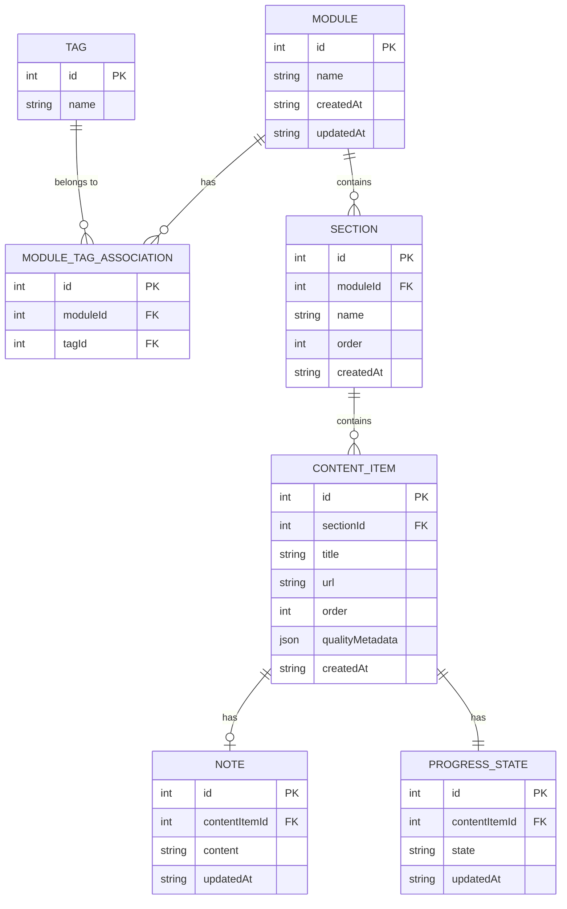

# Design Document — Study Materials Organizer

## Overview

The Study Materials Organizer is a 100% client-side Progressive Web App (PWA) built with **React 18**, **TypeScript**, **Tailwind CSS**, **Dexie.js** (IndexedDB wrapper), and **Vite** as the build tool. All data lives exclusively in the browser's IndexedDB; no backend server or cloud service is required for core functionality.

Key capabilities:

| Capability | Technology |
|---|---|
| UI framework | React 18 + TypeScript |
| Styling | Tailwind CSS v3 |
| Local persistence | Dexie.js 3.x (IndexedDB) |
| Routing | React Router v6 with `HashRouter` |
| State management | React Context + `useReducer` for transient UI state; `useLiveQuery` for reactive DB reads |
| Markdown rendering | `react-markdown` + `remark-gfm` |
| Web search | Pluggable `SearchAdapter` interface (default: YouTube Data API v3 + fallback) |
| Google Drive sync | Google Identity Services (GIS) PKCE flow — fully client-side |
| PWA / offline | Vite PWA plugin (`workbox-build`) with precaching + stale-while-revalidate |
| Property-based tests | `fast-check` + `Vitest` |

### Design Goals

1. **Offline-first** — all reads/writes hit IndexedDB; network is optional.
2. **Reactive UI** — `useLiveQuery` ensures the UI reflects the database without explicit refresh logic.
3. **Round-trip safety** — export → import must produce an identical state; this is enforced by a property-based test.
4. **Extensible search** — the `SearchAdapter` interface allows swapping search providers without touching UI code.
5. **Accessibility** — WCAG 2.1 AA compliance for keyboard navigation, focus management, and ARIA labeling.

---

## Architecture

### High-Level Diagram

```mermaid
graph TB
    subgraph Browser
        SW[Service Worker\nWorkbox precache]
        subgraph React App
            Router[HashRouter]
            Router --> Dashboard
            Router --> ModuleDetail[Module Detail Page]
            Dashboard --> ModuleCard
            Dashboard --> SearchBar
            Dashboard --> TagFilter
            ModuleDetail --> SectionAccordion
            SectionAccordion --> ContentItemRow
            ContentItemRow --> MarkdownEditor
            ContentItemRow --> QualityBadge
            ContentItemRow --> ProgressControl
        end
        subgraph Services
            DB[(Dexie.js\nIndexedDB)]
            ExportSvc[Export/Import Service]
            DriveSvc[Google Drive Service]
            SearchSvc[Search Service\nSearchAdapter]
        end
        React App -->|useLiveQuery / mutations| DB
        React App -->|triggers| ExportSvc
        React App -->|triggers| DriveSvc
        React App -->|queries| SearchSvc
        ExportSvc -->|reads/writes| DB
        DriveSvc -->|serialises via| ExportSvc
    end
    SW -->|caches| Browser
    SearchSvc -->|HTTP| ExternalAPI[Public Search API]
    DriveSvc -->|OAuth2 PKCE\nDrive REST| GoogleDrive[Google Drive API]
```

### Routing

`HashRouter` is used so the app works when served from a static file host (including `file://` and GitHub Pages) without server-side routing configuration.

| Path | Component |
|---|---|
| `#/` | `DashboardPage` |
| `#/modules/:moduleId` | `ModuleDetailPage` |

Navigation from a `ModuleCard` calls `navigate(`/modules/${module.id}`)`. The Back button on the detail page calls `navigate(-1)`.

### State Management Strategy

| Concern | Mechanism |
|---|---|
| Persisted data (modules, tags, etc.) | `useLiveQuery` — subscribes directly to Dexie; no manual cache invalidation needed |
| UI state (modals open, filter selections, search text) | `useReducer` inside each page-level component; not persisted |
| Global auth state (Google token) | `DriveAuthContext` (React Context) — token stored in `sessionStorage` only |
| PWA install prompt | `PwaInstallContext` — captures `beforeinstallprompt` event and exposes a trigger function |

---

## Components and Interfaces

### Component Tree

```
App
├── PwaInstallBanner
├── HashRouter
│   ├── DashboardPage
│   │   ├── SearchBar
│   │   ├── TagFilter
│   │   │   └── TagFilterChip (per tag)
│   │   ├── ModuleGrid
│   │   │   └── ModuleCard (per module)
│   │   │       └── TagBadge (per tag, max 5 + overflow count)
│   │   ├── CreateModuleModal
│   │   │   └── TagInput
│   │   └── EmptyState
│   └── ModuleDetailPage
│       ├── ModuleHeader (name, edit, tag management)
│       │   └── TagInput
│       ├── CollapseAllButton / ExpandAllButton
│       ├── SectionAccordion (per section)
│       │   ├── SectionHeader (name, toggle, add item)
│       │   ├── SectionProgress (x/y completed)
│       │   └── ContentItemRow (per item)
│       │       ├── ProgressControl
│       │       ├── QualityBadge
│       │       ├── MarkdownEditor
│       │       │   ├── MarkdownTextarea (edit mode)
│       │       │   └── MarkdownPreview (view mode)
│       │       └── DeleteItemButton
│       ├── AddSectionForm
│       ├── WebSearchPanel
│       │   ├── SearchQueryInput
│       │   └── SearchResultCard (per result)
│       │       └── QualityBadge
│       └── DriveControls
│           ├── ConnectDriveButton
│           ├── SyncToDriveButton
│           └── RestoreFromDriveButton
└── ExportImportToolbar (global, top nav)
```

### Key Component Contracts

#### `SearchBar`
```typescript
interface SearchBarProps {
  value: string;
  onChange: (value: string) => void; // debounced 100ms upstream
  placeholder?: string;
  maxLength?: number; // 200
}
```

#### `TagFilter`
```typescript
interface TagFilterProps {
  availableTags: Tag[];
  selectedTagIds: number[];
  onToggle: (tagId: number) => void;
}
```

##### Collapsible tag cloud (Req 5.9–5.14)

The public props are unchanged — collapse/expand is purely internal UI state (`const [expanded, setExpanded] = useState(false)`); the parent still owns `selectedTagIds` and `onToggle`. When `availableTags` is empty the component renders `null` (Req 5.14), exactly as today.

The control renders as a bounded-height header row regardless of how many tags exist, so a large tag set never pushes the module grid down the page (Req 5.9):

- **Trigger** — a single `<button>` labeled "Filter by tags". It carries `aria-expanded={expanded}` and `aria-controls` pointing at the cloud panel’s id, so it is keyboard operable and exposes its state to assistive tech (Req 5.13). When any tags are selected it appends the active count, e.g. "Filter by tags (3)" (Req 5.11). A caret/chevron icon rotates with `expanded` as an affordance.
- **Selected chips (always visible)** — the chips for the currently selected tags render inline next to the trigger in both collapsed and expanded states, each still a toggle button (clicking removes it via `onToggle`). This keeps active filters visible without expanding (Req 5.10). These reuse the existing selected-state `TagFilterChip` styling.

When `expanded` is true, the full tag cloud renders in-flow directly below the header row (not an overlay), so it pushes subsequent content (the module grid) down only while open and collapses back on toggle (Req 5.12):

- The cloud is a `flex flex-wrap gap-2` region (id matched by the trigger’s `aria-controls`) containing a `TagFilterChip` for every tag in `availableTags`, selected ones highlighted (Req 5.8, unchanged). Selecting/deselecting inside the cloud goes through the same `onToggle`, so the collapsed selected-chip row and the cloud stay in sync automatically.

Chip rendering, the 50-char label cap, AND-filter semantics, and `onToggle` wiring are all unchanged; this is a presentation-layer wrapper around the existing chips. No new props, no store or `filterModules` changes.

#### `TagInput`
```typescript
interface TagInputProps {
  selectedTags: Tag[];
  onAdd: (tag: Tag | NewTagName) => void;
  onRemove: (tagId: number) => void;
  maxTags?: number; // 10
  suggestions: Tag[]; // up to 20 matching existing tags
}
type NewTagName = { name: string }; // triggers tag creation
```

#### `TagBadge`
```typescript
interface TagBadgeProps {
  tag: Tag;
  onRemove?: () => void; // optional; shown in edit contexts
}
```

#### `QualityBadge`
```typescript
interface QualityBadgeProps {
  metadata: QualityMetadata;
}
// Only renders if at least one field is present — never shows placeholder values
```

#### `MarkdownEditor`
```typescript
interface MarkdownEditorProps {
  value: string;         // raw Markdown text
  onChange: (value: string) => void;
  onBlur: () => void;    // triggers DB persist
  maxLength: number;     // 10_000
  mode: 'edit' | 'preview';
  onToggleMode: () => void;
}
```

#### `MarkdownPreview`
```typescript
interface MarkdownPreviewProps {
  content: string; // rendered with react-markdown + remark-gfm
}
// Supports: H1-H3, bold, italic, inline code, code blocks, unordered lists
```

#### `ProgressControl`
```typescript
interface ProgressControlProps {
  state: ProgressState;
  onChange: (newState: ProgressState) => void;
}
```

### Service Interfaces

#### `SearchAdapter`
```typescript
export interface SearchResult {
  title: string;
  url: string;
  qualityMetadata?: QualityMetadata;
}

export interface SearchAdapter {
  search(query: string): Promise<SearchResult[]>;
}

// Default implementation: YouTubeSearchAdapter
// Fallback: OpenLibrarySearchAdapter (for non-video queries)
```

Quality score sorting (applied in `SearchService` after adapter returns results):
```typescript
function compositeScore(r: SearchResult): number {
  const rating = r.qualityMetadata?.rating ?? 0;
  const views  = r.qualityMetadata?.viewCount ?? 0;
  const domain = r.qualityMetadata?.domainRelevanceScore ?? 0;
  return rating * 1000 + views * 0.001 + domain * 10; // weights: rating > views > domain
}
results.sort((a, b) => compositeScore(b) - compositeScore(a));
```

#### `ExportImportService`
```typescript
export interface ExportFile {
  formatVersion: 1;
  exportedAt: string; // ISO-8601
  modules: Module[];
  tags: Tag[];
  moduleTagAssociations: ModuleTagAssociation[];
  sections: Section[];
  contentItems: ContentItem[];
  notes: Note[];
  progressStates: ProgressStateRecord[];
}

export interface ExportImportService {
  export(): Promise<ExportFile>;
  import(file: ExportFile): Promise<void>; // wipes DB then bulk-inserts
  validate(raw: unknown): raw is ExportFile; // JSON schema check
  downloadAsFile(data: ExportFile): void;   // triggers browser download
}
```
Filename format: `backup-YYYY-MM-DD.json` (date is export day in local timezone).

#### `GoogleDriveService`
```typescript
export interface DriveProgress {
  phase: 'authenticating' | 'uploading' | 'downloading' | 'done' | 'error';
  bytesTransferred?: number;
  totalBytes?: number;
}

export interface GoogleDriveService {
  authenticate(): Promise<void>;                  // GIS PKCE popup
  isAuthenticated(): boolean;
  syncToDrive(data: ExportFile, onProgress: (p: DriveProgress) => void): Promise<void>;
  restoreFromDrive(onProgress: (p: DriveProgress) => void): Promise<ExportFile>;
}
```
- Auth token stored in `sessionStorage` only (never `localStorage`).
- Folder "StudyOrganizer" is looked up by name before upload; created via `drive.files.create` if absent.
- Upload uses `multipart/form-data` to `https://www.googleapis.com/upload/drive/v3/files` with `uploadType=multipart`.
- While `phase` is not `done` or `error`, all Sync/Restore buttons are disabled in the UI.

---

## Data Models

### Dexie.js Database Definition

```typescript
import Dexie, { Table } from 'dexie';

export class StudyOrganizerDB extends Dexie {
  modules!: Table<Module, number>;
  tags!: Table<Tag, number>;
  moduleTagAssociations!: Table<ModuleTagAssociation, number>;
  sections!: Table<Section, number>;
  contentItems!: Table<ContentItem, number>;
  notes!: Table<Note, number>;
  progressStates!: Table<ProgressStateRecord, number>;

  constructor() {
    super('StudyOrganizerDB');
    this.version(1).stores({
      modules:               '++id, name, createdAt, updatedAt',
      tags:                  '++id, &name',               // unique name index
      moduleTagAssociations: '++id, moduleId, tagId, [moduleId+tagId]',
      sections:              '++id, moduleId, order',
      contentItems:          '++id, sectionId, order',
      notes:                 '++id, &contentItemId',       // 1-to-1 with contentItem
      progressStates:        '++id, &contentItemId',       // 1-to-1 with contentItem
    });
  }
}

export const db = new StudyOrganizerDB();
```

### TypeScript Entity Interfaces

```typescript
export interface Module {
  id?: number;
  name: string;           // 1–100 non-whitespace chars
  createdAt: string;      // ISO-8601
  updatedAt: string;      // ISO-8601
}

export interface Tag {
  id?: number;
  name: string;           // 1–30 chars, unique
}

export interface ModuleTagAssociation {
  id?: number;
  moduleId: number;
  tagId: number;
}

export interface Section {
  id?: number;
  moduleId: number;
  name: string;           // 1–100 non-whitespace chars
  order: number;          // display order within module
  createdAt: string;
}

export interface ContentItem {
  id?: number;
  sectionId: number;
  title: string;          // 1–200 chars
  url: string;            // http:// or https://, ≤2048 chars
  order: number;          // append-only; always increments
  qualityMetadata?: QualityMetadata;
  createdAt: string;
}

export interface QualityMetadata {
  viewCount?: number;
  rating?: number;        // 0.0–5.0 scale
  channelName?: string;   // for video results
  domainName?: string;    // for web results
  domainRelevanceScore?: number; // 0.0–1.0
}

export interface Note {
  id?: number;
  contentItemId: number;  // FK — unique (1-to-1)
  content: string;        // raw Markdown, ≤10,000 chars
  updatedAt: string;
}

export interface ProgressStateRecord {
  id?: number;
  contentItemId: number;  // FK — unique (1-to-1)
  state: ProgressState;
  updatedAt: string;
}

export type ProgressState = 'Not Started' | 'In Progress' | 'Completed';
```

### Entity Relationship Diagram



### Filtering Logic (Dashboard)

The dashboard filter is a pure function used both in the UI and in property-based tests:

```typescript
export function filterModules(
  modules: Module[],
  tagAssociations: ModuleTagAssociation[],
  query: string,
  selectedTagIds: number[],
): Module[] {
  const q = query.trim().toLowerCase();
  return modules.filter(m => {
    const nameMatch = q === '' || m.name.toLowerCase().includes(q);
    const tagMatch = selectedTagIds.length === 0 || selectedTagIds.every(tagId =>
      tagAssociations.some(a => a.moduleId === m.id && a.tagId === tagId)
    );
    return nameMatch && tagMatch;
  });
}
```

### Service Worker Caching Strategy

Implemented via `vite-plugin-pwa` (Workbox under the hood):

| Asset type | Strategy |
|---|---|
| App shell (HTML, JS, CSS, fonts, icons) | **Precache** — cached at install time, served from cache immediately |
| Google Identity Services script | **Stale-while-revalidate** — cached copy served instantly, updated in background |
| External search API calls | **Network-only** — never cached (results must be fresh) |
| Google Drive API calls | **Network-only** — data integrity requires live requests |

The service worker registers during the initial page load. On activation it takes control immediately (`clients.claim()`). Offline fallback serves the precached `index.html` for any navigation request that fails.


---

## Correctness Properties

*A property is a characteristic or behavior that should hold true across all valid executions of a system — essentially, a formal statement about what the system should do. Properties serve as the bridge between human-readable specifications and machine-verifiable correctness guarantees.*

### Property 1: Valid Module Names Are Persisted

*For any* string of 1–100 non-whitespace characters used as a Module name, creating a Module with that name succeeds, and subsequently reading the Module from the database returns an entity with the same name.

**Validates: Requirements 3.6**

---

### Property 2: Whitespace-Only Module Names Are Rejected

*For any* string composed entirely of whitespace characters (including the empty string), attempting to create a Module with that name is rejected, the database is unchanged, and the list of modules has the same length as before.

**Validates: Requirements 3.8**

---

### Property 3: Tag Assignment Round-Trip

*For any* valid Module and any valid Tag, assigning the Tag to the Module and then querying the Module's tags returns a list that includes that Tag.

**Validates: Requirements 4.4**

---

### Property 4: Tag Removal Removes Only the Target Tag

*For any* Module that has at least one Tag assigned, removing a specific Tag and then querying the Module's tags returns a list that does not contain the removed Tag, while all other previously assigned Tags remain present.

**Validates: Requirements 4.5**

---

### Property 5: Tag Count Upper Bound Is Enforced

*For any* Module that already has 10 Tags assigned, attempting to assign an 11th Tag is rejected, and the Module retains exactly 10 Tags in the database.

**Validates: Requirements 4.1**

---

### Property 6: Tag Name Length Boundary

*For any* string of 1–30 characters, creating a new Tag with that name succeeds. *For any* string whose length exceeds 30 characters, creating a Tag is rejected and no new Tag record is written to the database.

**Validates: Requirements 4.3**

---

### Property 7: Dashboard Name Filter — All Results Match the Query

*For any* list of Modules and any non-empty search query string, every Module returned by `filterModules` has a name that contains the query string (case-insensitive), and every Module whose name does not contain the query is absent from the results.

**Validates: Requirements 5.1**

---

### Property 8: Dashboard Tag Filter — AND Semantics

*For any* list of Modules, their `ModuleTagAssociation` records, and any non-empty set of selected Tag IDs, every Module returned by `filterModules` has all selected Tag IDs present in its associations, and every Module missing at least one selected Tag is absent from the results.

**Validates: Requirements 5.3**

---

### Property 9: Combined Name + Tag Filter

*For any* list of Modules, their associations, a query string, and a set of selected Tag IDs, every Module returned by `filterModules` satisfies both the name containment condition (case-insensitive) and the all-tags-present condition simultaneously.

**Validates: Requirements 5.4**

---

### Property 10: Section Expand/Collapse Toggle Is Idempotent Over Two Clicks

*For any* Section with a given expanded state (either expanded or collapsed), toggling the state twice returns the Section to its original expanded/collapsed state.

**Validates: Requirements 6.4**

---

### Property 11: ContentItem Append-Only Order Invariant

*For any* sequence of ContentItem additions to a Section, the `order` field of each newly created ContentItem is strictly greater than the `order` field of every ContentItem that existed in the Section before the addition, ensuring the new item always appears last.

**Validates: Requirements 7.3**

---

### Property 12: Note Persistence Round-Trip

*For any* ContentItem and any string of 1–10,000 characters, saving the string as the Note content and then reading the Note from the database returns the exact same string. *For any* string exceeding 10,000 characters, the save is rejected and the database retains the previously saved Note content unchanged.

**Validates: Requirements 8.2, 8.3**

---

### Property 13: ProgressState Persistence and Default

*For any* valid ContentItem, immediately after creation its ProgressState record in the database is "Not Started". *For any* ContentItem and any `ProgressState` value ("Not Started", "In Progress", "Completed"), setting the ProgressState and then reading it from the database returns the same value.

**Validates: Requirements 9.2, 9.6**

---

### Property 14: Quality Score Sort Order

*For any* list of `SearchResult` objects (with any combination of present or absent `QualityMetadata` fields), after the `SearchService` applies the composite score sort, every adjacent pair of results `(a, b)` satisfies `compositeScore(a) >= compositeScore(b)` (non-increasing order).

**Validates: Requirements 11.2**

---

### Property 15: Export–Import Round-Trip Fidelity

*For any* application state stored in the database, exporting it to an `ExportFile` and then importing that file into a freshly cleared database produces a database state where the set of all entities — Modules, Tags, `ModuleTagAssociations`, Sections, ContentItems, Notes, and ProgressStateRecords — including all fields, primary keys, foreign-key relationships, and ordering fields, is identical to the pre-export state.

**Validates: Requirements 12.6**

---

### Property 16: Invalid ExportFile Is Rejected Without State Mutation

*For any* JavaScript object that does not satisfy the `ExportFile` schema (missing required fields, wrong field types, absent `formatVersion`, etc.), calling `validate(raw)` returns `false` and no database write operations are performed, leaving the existing application state entirely unchanged.

**Validates: Requirements 12.5**

---

## Error Handling

### Strategy Overview

All user-visible errors follow a consistent pattern:
1. **Show** — display a non-blocking toast notification or inline error message.
2. **Preserve** — never discard user input; keep the last valid state in the UI.
3. **Revert** — if an optimistic UI update was applied, roll it back on failure.

### Error Categories

| Category | Examples | Handling |
|---|---|---|
| Dexie write failure | IndexedDB quota exceeded, corrupted store | Toast error with description; rollback optimistic UI update; log to console |
| Input validation failure | Empty name, oversized text, bad URL scheme | Inline field-level error message; form stays open |
| Note save failure (blur) | Dexie error during auto-save | Error toast; unsaved content retained in textarea; character counter unchanged |
| ProgressState persist failure | Dexie error | Toast error; ProgressControl reverts to previous state visually |
| Web search API failure | Network error, 4xx/5xx from provider | Error banner in `WebSearchPanel`; no ContentItem created |
| Web search empty results | API returned 0 results | Empty-state message in `WebSearchPanel` |
| Export failure | Serialization error | Toast error; no file download triggered |
| Import schema validation failure | Missing `formatVersion`, wrong types | Inline error listing failed validation rule; no DB write |
| Import Dexie bulk-write failure | Quota exceeded mid-import | Toast error; full rollback via Dexie transaction |
| Google OAuth failure | User denied permission, popup blocked | Error message explaining reason; no Drive operation attempted |
| Google Drive API failure | Network error, 403, 500 | Error message specifying upload vs. download; DB unchanged; progress indicator dismissed |

### Dexie Transaction Boundaries

- Every multi-table write (e.g., creating a Module + default ProgressState, or bulk-import) runs inside a single `db.transaction('rw', [...tables], async () => { ... })`.
- If the transaction throws, Dexie automatically rolls back all partial writes.
- The application treats the Dexie promise rejection as the error signal.

### Optimistic vs. Confirmed Updates

| Action | Update strategy |
|---|---|
| ProgressState change | Optimistic — update UI immediately, revert on Dexie rejection |
| All other mutations | Confirmed — wait for Dexie resolution before updating UI |

---

## Testing Strategy

### Dual Testing Approach

Every testable acceptance criterion is covered by either a unit/example-based test or a property-based test (or both where appropriate). The two approaches are complementary:

- **Unit / example tests** — specific scenarios, edge cases, UI behavior, error states.
- **Property-based tests** — universal invariants across a wide input space (Properties 1–16 above).

### Technology Stack

| Tool | Purpose |
|---|---|
| **Vitest** | Test runner + assertion library |
| **fast-check** | Property-based test library (100+ iterations per property) |
| **@testing-library/react** | Component unit tests |
| **Playwright** | E2E tests (routing, offline, breakpoints, debounce timing) |
| **fake-indexeddb** | In-memory Dexie backend for fast unit/property tests |
| **msw** (Mock Service Worker) | Mock search API and Google Drive API calls |

### Property-Based Test Configuration

Each property test uses `fc.assert(fc.asyncProperty(...), { numRuns: 100 })` or `fc.assert(fc.property(...), { numRuns: 200 })` for pure functions.

Each test is tagged with a comment referencing its design property:

```typescript
// Feature: study-materials-organizer, Property 15: Export–Import Round-Trip Fidelity
it('export then import produces identical state', async () => {
  await fc.assert(fc.asyncProperty(arbitraryAppState(), async (state) => {
    await seedDatabase(state);
    const exported = await exportImportService.export();
    await clearDatabase();
    await exportImportService.import(exported);
    const restored = await exportImportService.export();
    expect(restored).toEqual(exported);
  }), { numRuns: 100 });
});
```

### Unit Test Coverage Areas

| Area | Test type | Key scenarios |
|---|---|---|
| `TagInput` autocomplete | Unit (RTL) | Shows up to 20 suggestions; creates new tag on unknown input |
| `ModuleCard` tag overflow | Unit (RTL) | 5 tags shown, +N badge for overflow; exactly 5 shown when count = 5 |
| `MarkdownEditor` toggle | Unit (RTL) | Click toggle switches mode; two clicks returns to original mode |
| `MarkdownPreview` rendering | Unit (RTL) | H1–H3, bold, italic, inline code, code blocks, unordered lists all render |
| `QualityBadge` absent metadata | Unit (RTL) | No badge elements rendered when metadata is undefined |
| `ProgressControl` revert | Unit (RTL) | DB failure triggers revert to previous state |
| Dashboard empty state | Unit (RTL) | Empty modules array shows CTA |
| Filter no-results state | Unit (RTL) | All-filtered-out modules shows no-results message |
| Import confirmation modal | Unit (RTL) | Cancel does not trigger import; confirm triggers import |
| Drive progress indicator | Unit (RTL) | Buttons disabled during uploading/downloading phase |
| Drive folder creation | Integration (msw) | Folder-not-found response triggers create call before upload |

### E2E Test Coverage Areas

| Scenario | Tool |
|---|---|
| Full offline load after first visit | Playwright (setOffline) |
| Dashboard → Module detail navigation | Playwright |
| Responsive layout at 320px, 640px, 768px, 1024px, 1920px | Playwright screenshots |
| 100ms debounce on search bar | Playwright fake timers |
| Export file download + re-import | Playwright file intercept |

### Performance / Smoke Tests

| Check | Tool |
|---|---|
| Dashboard load < 3s (Lighthouse mobile) | Lighthouse CI |
| Service worker precaches all assets | Playwright + Cache API assertion |
| DB restore < 3s for 10,000 records | Vitest benchmark (fake-indexeddb) |

---

## Search-Driven Module Generation (Requirement 14)

This capability adds a Dashboard-level "Discover" flow that turns an internet search into a ready-to-save Module whose Sections are grouped by content type. It reuses the existing pluggable `SearchAdapter` interface and the `compositeScore` sort; it does not replace the manual creation flows or the per-Section web search.

### Content-type classification

A pure function `classifyContentType(result: SearchResult): ContentType` maps each result to exactly one bucket. `ContentType = 'Video' | 'Article' | 'Course' | 'Book'`.

- **Video** — any result whose `source` is the video adapter (YouTube).
- **Course** — web results whose hostname matches a course-platform list: `udemy.com`, `coursera.org`, `edx.org`, `khanacademy.org`, `pluralsight.com`, `udacity.com`, `codecademy.com`, `futurelearn.com`, `skillshare.com`.
- **Book** — web results whose hostname/path matches a books list: `amazon.*` with `/dp/` or `/gp/`, `goodreads.com`, `oreilly.com`, `books.google.*`, `openlibrary.org`, `manning.com`, `packtpub.com`, `leanpub.com`.
- **Article** — the catch-all for every other web result.

The matching is deterministic and inspectable (a small exported constant table of host patterns), so it is covered by unit and property tests. Hostnames are compared case-insensitively after parsing the URL; a malformed URL falls back to `Article`.

### Search sources

| Source | Adapter | Credentials | Content types produced |
|---|---|---|---|
| YouTube Data API v3 | `YouTubeSearchAdapter` (existing) | API key | Video |
| Google Programmable Search (CSE) JSON API | `GoogleCseSearchAdapter` (new) | API key + Search Engine ID (`cx`) | Article / Course / Book (via classification) |

`GoogleCseSearchAdapter implements SearchAdapter` with `name = 'web'`. It calls `https://www.googleapis.com/customsearch/v1?key=<key>&cx=<cx>&q=<query>` via `fetch`, maps each item to a `SearchResult` (`title`, `url` = item.link, `source: 'web'`, and `qualityMetadata.domainName` from the result host). Network/HTTP/JSON failures throw descriptive errors, matching `YouTubeSearchAdapter`.

Credentials are entered in the UI and stored in `localStorage` (`youtube_api_key`, `google_cse_api_key`, `google_cse_cx`) — never hardcoded, never sent anywhere but the provider. This mirrors the existing YouTube-key handling.

### Module generation service (`src/services/moduleGenerationService.ts`)

```ts
export type ContentType = 'Video' | 'Article' | 'Course' | 'Book';

export interface GeneratedSectionPreview {
  type: ContentType;
  results: SearchResult[]; // already composite-score sorted
}

export interface GeneratedModulePreview {
  name: string;           // defaults to the query; editable
  sections: GeneratedSectionPreview[]; // only non-empty types, in fixed order
}

// Pure: group + classify + sort. No DB access.
export function generateModulePreview(query: string, results: SearchResult[]): GeneratedModulePreview;

// Persists the preview in ONE db.transaction('rw', [modules, sections, contentItems, progressStates], ...)
// Creating module -> sections (order by fixed type order) -> content items (append order per section)
// + a default 'Not Started' ProgressStateRecord per item. Returns the new module id.
export async function saveGeneratedModule(preview: GeneratedModulePreview): Promise<number>;
```

`generateModulePreview` is pure and deterministic (so property tests can assert the grouping invariant: every input result lands in exactly one section and no result is dropped or duplicated). Section order is fixed: Video, Article, Course, Book — skipping empty types.

### Components

- **`DiscoverSearchPanel`** (`src/components/DiscoverSearchPanel.tsx`) — mounted on `DashboardPage` above the saved-modules area, clearly separated from the existing name/tag `SearchBar`/`TagFilter`. Holds the Discover query input, the credential inputs (YouTube key, CSE key, CSE cx) persisted to `localStorage`, a Search button, and loading/error/empty states. On search it runs both adapters, concatenates results, calls `generateModulePreview`, and renders a `GeneratedModulePreview`.
- **`GeneratedModulePreview`** (`src/components/GeneratedModulePreview.tsx`) — shows the editable module name (defaults to query) and the grouped sections with their results (reusing `QualityBadge` and the result-row styling from `WebSearchPanel`). A "Save module" button calls `saveGeneratedModule`; a "Discard" button clears the preview. Nothing is written until Save.

### Dashboard integration

`DashboardPage` renders `DiscoverSearchPanel` at the top. After a successful save, the existing `useLiveQuery` module subscription makes the new `ModuleCard` appear automatically (sequential-await reads already ensure live reactivity). The two search concepts stay visually and functionally distinct: **Discover** = internet search that generates a module; **Filter/Search bar** = narrows the already-saved modules.

### Error / empty handling

- If both adapters throw, show an error and present no preview (Req 14.9).
- If adapters succeed with zero combined results, show an empty-state and no preview (Req 14.10).
- If only one source is configured (e.g. no CSE credentials), run the available source(s) and classify what returns; surface a non-blocking notice that the web source was skipped.

---

## Settings Page and Selective Backup (Requirements 15 & 16)

### Routing and navigation

A third route is added: #/settings -> SettingsPage. The Dashboard shows a gear/Settings control (top-right) that navigates to it; the Settings page has a Back control (navigate(-1) or to /). The Export/Import and Google Drive controls are REMOVED from ModuleDetailPage and live only here.

| Path | Component |
|---|---|
| #/ | DashboardPage (minimalist: Discover search hero, manual-create, module grid) |
| #/modules/:moduleId | ModuleDetailPage |
| #/settings | SettingsPage |

### SettingsPage structure

SettingsPage renders three cards:
1. **API Keys** (ApiKeysSettings) — inputs for youtube_api_key, google_cse_api_key, google_cse_cx, each persisted to localStorage. Shows a Set / Not set status per field and an update/clear action. These are the single source of truth the Discover flow (Req 14) reads from.
2. **Export / Import** (ExportImportSettings) — the selective backup UI (below). Replaces the old global ExportImportToolbar.
3. **Google Drive** (DriveSettings) — the existing DriveControls, extended to use the same module selection for backup/restore.

### Selective backup data model

The existing ExportFile shape is reused unchanged — a selective export is simply an ExportFile whose arrays contain only the chosen modules and their dependent rows. One format, preserving the Requirement 12 round-trip property.

### Selective export (exportSelectedModules)

```ts
export async function exportSelectedModules(moduleIds: number[]): Promise<ExportFile>;
```

Reads only the selected modules; then sections whose moduleId is in the set; then contentItems whose sectionId is in those sections; then notes/progressStates whose contentItemId is in those items; then moduleTagAssociations for the selected modules and the tags they reference. Produces a self-contained ExportFile. Download reuses serializeExport.

### Merge import with ID remapping (importModulesMerge)

```ts
export async function importModulesMerge(file: ExportFile, moduleIds: number[]): Promise<void>;
```

The risk-sensitive core. Runs in ONE db.transaction(rw, [all tables], ...) and NEVER clears existing data (merge-only, Req 16.4). Algorithm:
1. Validate the file (validateExportFile).
2. Filter the file arrays to the selected moduleIds and their dependent rows.
3. Build an id-remap per entity type: insert each imported row WITHOUT its old id (Dexie autoincrements a fresh one) and record oldId -> newId maps for modules, sections, contentItems.
4. **Tags**: for each imported tag, look up an existing tag with the same normalized name. If found, map oldTagId -> existingTagId (reuse, Req 16.6); else create it and map to the new id.
5. Re-link via the maps: sections get new moduleId; contentItems get new sectionId; notes and progressStates get new contentItemId; moduleTagAssociations get new moduleId + mapped tagId (skip if that association already exists).
6. Every write uses fresh ids and remapped foreign keys, so no imported id collides and no relationship breaks (Req 16.5).

A property test asserts: after importModulesMerge into a non-empty DB, (a) all pre-existing modules remain unchanged, (b) the selected imported modules exist with full section/item/note/progress trees, and (c) no duplicate tag names were created.

### Components

- SettingsPage, ApiKeysSettings, ExportImportSettings, DriveSettings (new).
- ModuleSelectList (new, reusable) — checkbox list of modules with select-all/none; used by export, import, and Drive restore; defaults to all selected; disables confirm when none selected (Req 16.9).
- GoogleCseSearchAdapter reads its key/cx from the Settings-managed localStorage values.

### Dashboard (minimalist) layout (ties Req 14 + 15)

DashboardPage top-to-bottom: (1) a slim top bar with the app title and a Settings gear; (2) a centered **Discover** search hero with generous whitespace (the visual focus); (3) a secondary Create module manually action; (4) the saved-module grid with the existing name/tag filter kept secondary/compact. A calm, single-focus screen: search first, everything else quiet.

---

## Editing and Deletion (Requirements 17 & 18)

### Cascade-delete service (src/db/deleteService.ts)

All deletes are cascading and atomic — one db.transaction('rw', [...tables]) per operation, so a failure rolls everything back (Req 18.7). Tag entities are never deleted (only the module-tag associations are), matching the tag-reuse policy.

```ts
export async function deleteContentItem(contentItemId: number): Promise<void>;
export async function deleteSection(sectionId: number): Promise<void>;
export async function deleteModule(moduleId: number): Promise<void>;
```

- deleteContentItem: deletes the ContentItem, its Note (by contentItemId), and its ProgressStateRecord (by contentItemId).
- deleteSection: finds the section's content items, deletes their notes + progress, deletes the content items, then the section.
- deleteModule: finds the module's sections -> their content items -> their notes + progress; deletes all of those bottom-up, then the sections, then the module's moduleTagAssociations, then the module. Tags themselves are preserved.

Because these are plain services over the singleton db, they are covered by fake-indexeddb property/unit tests: after a cascade delete, no orphan rows remain in any descendant table, and sibling/unrelated rows are untouched.

### Edit flows (Requirement 17)

- **ContentItem edit** — ContentItemRow gains an edit toggle that swaps the display row for an inline editor (title + url inputs, optional quality rating) reusing AddContentItemForm's validation (title 1-200, url http(s), <=2048). On save: db.contentItems.update(id, { title, url, ... }). Cancel restores the saved values. Persistence is reactive via useLiveQuery.
- **Section rename** — SectionAccordion header gains an edit affordance; inline input validated 1-100 non-whitespace; on save db.sections.update(id, { name }).
- A new ContentItem edit is distinct from its Note (notes already edit via MarkdownEditor) and its ProgressControl, which keep working unchanged.

### Delete UI

- A single reusable ConfirmDialog component (role=dialog, aria-modal, focus trap, Escape to cancel, backdrop click cancels) names the target and lists what will be removed. Reused by all three delete controls.
- ContentItemRow: a delete (trash) icon button -> ConfirmDialog -> deleteContentItem.
- SectionAccordion header: a delete icon button -> ConfirmDialog (warns it removes the section and its N items) -> deleteSection.
- ModuleHeader: a delete button -> ConfirmDialog (warns it removes the whole module and everything in it) -> deleteModule, then navigate('/').
- All controls meet the 44px touch-target minimum and are keyboard operable.

---

## Selective Save of Discover Results (Requirement 19)

GeneratedModulePreview becomes selection-aware. It keeps a Set of selected result keys (default: all results selected). Each result row has a checkbox; each section heading has a tri-state-style section toggle that selects/clears all of its results. A result's identity key is its url within its section (stable within a single preview).

On Save, the panel derives a FILTERED GeneratedModulePreview containing only the selected results, drops any section left with zero selected results, and passes that to saveGeneratedModule — so no extra persistence logic is needed and the existing composite-score ordering is preserved (Req 19.5). Save is disabled when the selection is empty, with an inline hint (Req 19.4).

generateModulePreview and saveGeneratedModule are unchanged; selection is purely a preview-layer concern applied just before save. The grouping-is-total-and-disjoint property for generateModulePreview therefore still holds.

---

## Content Item Thumbnails (Requirement 20)

### Pure derivation util (src/utils/thumbnail.ts)

A pure function derives a thumbnail descriptor from a URL at render time; nothing is persisted.

```ts
export type ThumbnailKind = 'youtube' | 'favicon' | 'none';
export interface ThumbnailInfo { kind: ThumbnailKind; src?: string; }
export function getThumbnail(url: string): ThumbnailInfo;
```

Rules:
- Parse the URL (try/catch). On failure -> { kind: 'none' } (caller shows the type fallback icon).
- **YouTube**: if the host is youtube.com/www.youtube.com/m.youtube.com with a ?v=<id>, or youtu.be/<id>, or /shorts/<id> or /embed/<id> -> src = https://img.youtube.com/vi/<id>/mqdefault.jpg, kind 'youtube'. The video-id extraction is small and unit-testable.
- **Otherwise**: src = https://www.google.com/s2/favicons?domain=<host>&sz=64, kind 'favicon'.

### Thumbnail component (src/components/ContentThumbnail.tsx)

- Props: { url: string; contentType?: ContentType; className?: string }.
- Renders a fixed ~44px rounded square. For kind 'youtube' it shows the video thumbnail cover-cropped; for 'favicon' it centers the small favicon on a neutral tile; for 'none' it shows the type fallback icon immediately.
- Uses an  with onError that swaps to the type fallback icon (so a blocked favicon or removed video never shows a broken image) — Req 20.4. React key includes the src so a changed URL re-attempts loading.
- The  has alt="" and the wrapper is aria-hidden: the thumbnail is decorative; the title link remains the accessible label (Req 20.6).
- Fallback icons are inline SVGs chosen by contentType: video, course, book, and a generic document for article/unknown. contentType is optional; the row can pass the classifyContentType result or omit it (defaults to the document icon).

### Integration

- **ContentItemRow** (display mode): render <ContentThumbnail url={item.url} .../> as the first child of the row, before the title link, with the title/metadata in a flex-1 min-w-0 column so long titles wrap and nothing overflows. Edit mode is unchanged.
- **GeneratedModulePreview** result rows: render the same <ContentThumbnail> at the left of each result, passing the section's content type so the fallback matches (Video/Article/Course/Book).
- Classification reuse: the preview already knows each section's ContentType; ContentItemRow can derive it via classifyContentType(url-based SearchResult-like) or simply omit contentType and rely on the youtube/favicon result plus the generic fallback.

No DB schema or type changes. getThumbnail is pure and covered by unit tests (youtube variants, youtu.be, shorts, non-youtube favicon, malformed URL -> none).

---

## Global Navigation Header (Requirement 21)

The consolidated nav bar currently baked into DashboardPage is extracted into a shared `AppHeader` and rendered once around every route, so Home / Create / Settings / module-search are reachable from the Dashboard, Module detail, and Settings alike (Req 21.1).

### Layout wrapper (src/App.tsx)

A small `AppLayout` wraps the `<Routes>`: it renders `<AppHeader />` above an `<Outlet />` (or above `{children}`) so the header is a sibling of, and persists across, all route content. Because routing is `HashRouter`, `AppHeader` uses `useNavigate` and `useLocation` from react-router — it must be rendered inside the router, i.e. the layout lives under `<HashRouter>`. The three `<Route>`s are unchanged except that their pages no longer render their own top bar.

### AppHeader (src/components/AppHeader.tsx)

Presentational + navigation only; owns no module data. Left-to-right: a wordmark/Home button, a Home icon, the module-search input (flex-1), a Create button, and a Settings gear — the same controls as the old Dashboard bar (Req 21.2). It is responsive: secondary text labels collapse to icons on narrow viewports while every control keeps a >=44px target and stays keyboard operable, and the row never overflows horizontally (Req 21.8).

- **Home / Settings** — `navigate('/')` and `navigate('/settings')`. Safe to activate even when already on that route (a no-op navigation), so no guard is needed (Req 21.3).
- **Module search** — a controlled input seeded from the URL. On change (debounced, matching the existing <=100ms Dashboard behavior) and on submit it calls `navigate({ pathname: '/', search: q ? ?q=<encoded> : '' })`, so searching from any page lands on the filtered Dashboard (Req 21.4). The term lives only in the URL query param `q` (no new global store), making the filtered view bookmarkable/shareable (Req 21.5). The input value is derived from the current `q` so it reflects the active term.
- **Create** — when already on the Dashboard it opens the create-module modal directly; from any other page it navigates to the Dashboard with a signal to open the modal (a second query param, e.g. `?new=1`), which the Dashboard consumes on mount (Req 21.6).

### Dashboard changes (src/pages/DashboardPage.tsx)

DashboardPage stops rendering its own bar and instead reads navigation intent from the URL via `useSearchParams`:

- It initializes/syncs the name-filter portion of its existing filter state from `q` (Req 21.5). The name filter keeps Requirement 5 semantics exactly — case-insensitive containment, up to 200 chars — and still combines with the tag filter through the unchanged `filterModules` (Req 21.7). The query input in the header replaces the in-body `SearchBar`; the reducer and `filterModules` call are otherwise untouched.
- If `new=1` (or equivalent) is present, it opens the CreateModuleModal on mount and then clears that param so a refresh does not reopen it (Req 21.6).
- The collapsible tag cloud (Req 5.9–5.14) stays in the Dashboard body, below the Discover hero, and is NOT moved into the header (Req 21.9).

ModuleDetailPage and SettingsPage simply drop any local top-bar markup; the shared header now sits above them. No store, schema, or `filterModules` changes are required — this is a composition/routing refactor plus URL-param plumbing.

---

## Multi-Source Search with Trust-Aware Ranking (Requirement 22)

Today a search fans out to at most two adapters (YouTube + optional Google CSE), and the composite score only ever receives YouTube `viewCount` — so ranking by rating/authority is structurally present but never fed. Requirement 22 adds several credential-free sources, extends the quality signals the score consumes, and surfaces the ranking rationale. The existing `SearchAdapter` seam makes this additive: every new source is just another `SearchAdapter`.

### Source registry (src/services/searchSources.ts)

A single inspectable registry is the source of truth for which adapters exist, whether each needs credentials, and its baseline authority weight (Req 22.13). The Discover flow and the per-section panel both build their adapter list from this registry, so every search surface stays in sync (Req 22.11).

```ts
export interface SourceDescriptor {
  id: string;                 // SearchResult.source, e.g. "stackexchange"
  label: string;              // human label for the transparency badge, e.g. "Stack Overflow"
  authority: number;          // 0..1 baseline trust weight for this source
  requiresCredentials: boolean;
  build: () => SearchAdapter | null; // null when required credentials are missing
}
export const SEARCH_SOURCES: readonly SourceDescriptor[];
export function buildActiveAdapters(): { adapters: SearchAdapter[]; skipped: SourceDescriptor[] };
```

`buildActiveAdapters()` returns the adapters that are usable now plus the descriptors skipped for missing credentials, so the UI can show a single non-blocking notice listing skipped sources (Req 22.3). Credential-free sources (Wikipedia, Stack Exchange, Dev.to, Open Library) always build; YouTube and Google CSE build only when their stored keys exist (Req 22.2).

Indicative baseline authority weights (inspectable and adjustable — Req 22.6/22.13): Wikipedia 0.9, Stack Exchange 0.8, Open Library 0.75, YouTube 0.6, Dev.to 0.55, Google CSE 0.4. These are starting values, not magic constants; they live in the registry for easy review.

### New adapters (all client-side, no credentials, best-effort)

Each implements `SearchAdapter` (`search(query) => Promise<SearchResult[]>`), normalizes to the common shape, tags `source` with its registry id, and populates whatever quality signals it can. Each is best-effort: on network/CORS/HTTP failure it rejects, and the caller already isolates per-source failures via `Promise.allSettled` so one failing source never fails the whole search (Req 22.10).

- **WikipediaSearchAdapter** (`src/services/WikipediaSearchAdapter.ts`) — MediaWiki REST/`action=query` search on `*.wikipedia.org` (CORS-enabled, `origin=*`). Maps each hit to a result whose URL is the article page; popularity signal = article size or pageviews mapped into the view-count signal; classified as Article. Reference-grade, so it leans on the high source authority.
- **StackExchangeSearchAdapter** (`src/services/StackExchangeSearchAdapter.ts`) — Stack Exchange API 2.3 (`/search/advanced` on site=stackoverflow, CORS-enabled, no key needed for low volume). Carries the question/answer **score (votes)** as the rating signal and the asker/answerer **reputation** as the author-authority signal; classified as Article. This is the richest trust source (community votes + author reputation).
- **DevToSearchAdapter** (`src/services/DevToSearchAdapter.ts`) — dev.to `/api/articles?q=` (or tag/keyword listing). Uses positive reactions + comment count as the rating signal; classified as Article/blog. Treated as best-effort: if dev.to blocks the browser request via CORS it is simply skipped (degrades gracefully, Req 22.10).
- **OpenLibrarySearchAdapter** (`src/services/OpenLibrarySearchAdapter.ts`) — Open Library `/search.json` (CORS-enabled, no key). URL points at the work page; edition count / readinglog counts map into popularity; classified as Book (its `source` also makes classifyContentType return Book — see below).

YouTube and Google CSE adapters are unchanged and remain in the registry (YouTube credentialed, CSE optional — Req 22.12).

### Quality metadata + score extension (src/db/types.ts, src/services/searchService.ts)

`QualityMetadata` gains optional signals so sources can express rating/authority without faking anything (absent fields stay absent — Req 22.8):

```ts
export interface QualityMetadata {
  viewCount?: number;        // existing popularity signal
  rating?: number;           // existing 0..5 rating
  channelName?: string;      // existing (display)
  domainName?: string;       // existing (display)
  domainRelevanceScore?: number; // existing 0..1
  // --- added for Req 22 ---
  communityScore?: number;   // raw up/downvote or reaction score (e.g. SE score, dev.to reactions)
  authorReputation?: number; // raw author reputation where exposed (e.g. SE user rep)
  sourceAuthority?: number;  // 0..1 baseline authority of the producing source (from the registry)
  signals?: string[];        // human-readable rationale chips, e.g. ["1.2k votes", "reference"]
}
```

`compositeScore` keeps its existing three terms (rating, view, domain) and adds an **authority** term plus folds the community score into the rating signal, all normalized to ~0..1 before weighting so weights express relative importance directly (Req 22.5/22.7):

- rating term: max(normalized `rating`/5, normalized log-scaled `communityScore`) — so a highly up-voted Stack Overflow answer scores like a well-rated item even though it has no 0..5 rating.
- view term: unchanged (log-scaled `viewCount`).
- authority term (new): combines `sourceAuthority` (already 0..1) with a log-normalized `authorReputation` when present; weighted between the view and domain terms.
- domain term: unchanged.

Weights remain inspectable constants (indicative: rating 1.0, authority 0.7, view 0.5, domain 0.25). The function stays pure and deterministic, so the existing property tests (and new ones) cover it. `sortByCompositeScore` is unchanged (stable, descending, deterministic tie-break — Req 22.7).

### Classification extension (src/utils/classifyContentType.ts)

`classifyContentType` gains two source-aware shortcuts before the URL heuristics: a result whose `source` is the Open Library adapter classifies as **Book**, and a result from a course platform stays **Course** (existing host table). Everything else keeps the current behavior (YouTube -> Video; known book/course hosts; otherwise Article). This keeps grouping total and disjoint, so Requirement 14.3 and the generation grouping property still hold.

### Transparency indicator (src/components/SourceBadge.tsx)

A small presentational `SourceBadge` renders the producing source label plus the concrete signals behind the ranking, read from `qualityMetadata.signals` (built by each adapter from real values — votes, views, reputation, "reference"). It never shows a signal the result lacks (Req 22.8). It is added to the result rows in `GeneratedModulePreview` and `WebSearchPanel` next to the existing `QualityBadge`.

### Wiring the search surfaces

- **DiscoverSearchPanel** stops hand-building the YouTube/CSE pair and instead calls `buildActiveAdapters()`, runs them with the existing `Promise.allSettled` fan-out, concatenates results, and feeds `generateModulePreview` (which already groups + sorts). The skipped-source notice is generalized to list any skipped credentialed sources (Req 22.3).
- **WebSearchPanel** (per-section) switches from its single hard-coded `YouTubeSearchAdapter` to the same `buildActiveAdapters()` fan-out, so an in-section search now returns all media types and adds the chosen result as a ContentItem exactly as today (Req 22.11). Its heading/help text is updated to reflect multi-source, multi-media results.
- A shared helper (e.g. `runMultiSourceSearch(query)` in `searchService.ts`) encapsulates build -> allSettled -> flatten -> sort so both panels share identical behavior and only differ in presentation.

### Failure + empty semantics

With `Promise.allSettled`: if at least one source yields results, present them (Req 22.10); if all sources fail, show the search-failed error; if sources succeed but return zero combined results, show the empty state (Req 22.9). CORS/host blocks count as that source failing and are swallowed into the skipped/failed set rather than surfacing as a hard error.

### Testing

- Pure units: extended `compositeScore` (community/authority terms, normalization bounds), `classifyContentType` (Open Library -> Book, course hosts), and each adapter’s response-mapping via mocked fetch (MSW) — asserting signals are populated only from real fields and `source` is tagged correctly.
- Property tests: ranking remains a total order with deterministic tie-breaks; grouping stays total and disjoint after the classification change.
- No DB schema/version change — `QualityMetadata` is an open value object already stored as-is; new optional fields are backward compatible with existing exports.

---

## Three-Column Dashboard with Pinning and Reordering (Requirement 23)

The Dashboard changes from a single centered column (Discover hero + a saved-module grid) into a three-column workspace: left = all Modules, center = Discover, right = started Modules. Pin state and manual order are tracked independently per column and persisted locally. This is a Dashboard-layout + persistence feature; it does not change Module/Section/ContentItem semantics.

### Data model: per-column dashboard preferences (Dexie v2 migration)

A new table stores pin/order per Module per column. Bumping the Dexie schema to version(2) is additive (new store only), so existing data is untouched and the export/import ExportFile shape is unaffected (dashboard prefs are view state, intentionally NOT part of the backup payload).

```ts
export type DashboardColumn = 'all' | 'started';
export interface DashboardPref {
  id?: number;
  moduleId: number;
  column: DashboardColumn;   // which column this pin/order applies to
  pinned: boolean;
  order: number;             // manual position within its pinned/unpinned group
}
```

db.ts gains `this.version(2).stores({ ...v1, dashboardPrefs: '++id, moduleId, column, [moduleId+column]' })`. The compound index `[moduleId+column]` makes the per-module-per-column row a fast unique lookup. No `.upgrade()` data transform is needed because the table starts empty and absence of a row means 'unpinned, default order' (Req 23.8).

### Preferences service (src/db/dashboardPrefsService.ts)

A thin service owns all reads/writes so the UI never touches the table directly, and all multi-row writes run in one `db.transaction('rw', db.dashboardPrefs, ...)` for atomicity:

```ts
getPrefs(column): Promise<DashboardPref[]>;                 // all rows for a column
setPinned(moduleId, column, pinned): Promise<void>;         // upsert pinned flag
reorder(column, orderedModuleIds: number[]): Promise<void>; // persist a full column order
removeModulePrefs(moduleId): Promise<void>;                 // both columns (delete cleanup)
```

- `reorder` writes a dense `order` (0..n-1) for the given column from the UI's post-drag array, upserting a row per module. Pinned/unpinned grouping is derived at render time (see ordering util), so `order` is just a within-column sequence.
- `removeModulePrefs(moduleId)` is called from the existing cascade delete (`deleteModule`, Req 18) so deleting a Module clears its pin/order rows in both columns (Req 23.10). deleteService.ts gains this one call inside its existing transaction (extended to include the dashboardPrefs table).

### Started detection + ordering (pure utils)

- `isModuleStarted(moduleId, sections, contentItems, progressStates): boolean` — true when any ContentItem under the Module has ProgressState In Progress or Completed (Req 23.2). Reuses the same table data the Dashboard already live-queries; the right column is simply the Modules that pass this predicate.
- `orderModulesForColumn(modules, prefsForColumn): Module[]` — pure, deterministic sort (safe for unit/property tests): partition into pinned vs unpinned using the column's prefs, sort each group by `order` ascending, and for Modules with no pref row fall back to a deterministic default (updatedAt desc, then id) so the result is stable and total (Req 23.8). Pinned group is concatenated before unpinned (Req 23.5).

### Drag-and-drop (new dependency: @dnd-kit)

Reordering uses `@dnd-kit/core` + `@dnd-kit/sortable` (+ `@dnd-kit/accessibility`). Rationale: it is lightweight, pointer + keyboard operable out of the box (arrow keys move a grabbed item, with screen-reader announcements), which satisfies Req 23.13 without hand-rolling a11y. A hand-built HTML5 drag implementation would not meet the keyboard requirement cleanly. This is the only new runtime dependency; it is tree-shakeable and client-side.

Each column is a `SortableContext` (vertical list strategy) wrapping sortable `ModuleCard` items; only the unpinned-vs-pinned grouping is visual — a drag that crosses the pin divider is clamped so pinned items stay in the pinned group (reorder within group). On drag end the column's new `orderedModuleIds` is handed to `dashboardPrefsService.reorder(column, ids)`. A keyboard sensor provides the equivalent move-within-column affordance.

### Components

- **`ModuleColumn`** (`src/components/ModuleColumn.tsx`) — a titled, independently scrollable (`overflow-y-auto` with a bounded max-height / flex min-h-0) column that renders a `SortableContext` of module cards, shows a per-column empty state, and raises `onReorder(ids)` / `onTogglePin(moduleId)`. Used for BOTH the left and right columns with different inputs, so pin/order stay independent per column (Req 23.7).
- **`ModuleCard`** gains an optional pin toggle control (a small pin button with `aria-pressed`) and a drag handle; existing card content (name, tags, progress) is unchanged. The pin/drag affordances are only rendered when the card is used inside a `ModuleColumn` (the Discover preview reuse is unaffected).
- **`DashboardPage`** is refactored from the centered single column into a responsive 3-column CSS grid: `lg:grid-cols-[minmax(0,20rem)_minmax(0,1fr)_minmax(0,20rem)]` with the center flexible and the side columns a bounded width. The existing live query (modules + associations + tags + sections + contentItems + progressStates) is extended to also read `dashboardPrefs`; `useLiveQuery` already makes pin/order changes reactive.

### Layout, filtering, and responsive behavior

- Left column = `orderModulesForColumn(filterModules(all, ...q, tags), allPrefs)` so the existing name/tag filter (Req 5) still applies to the left list only (Req 23.12); the TagFilter stays at the top of the left column. Right column = `orderModulesForColumn(startedModules, startedPrefs)` and is NOT filtered by the left column's query (it is a separate working set).
- The global AppHeader (Req 21) remains above the grid; its module search still drives the `q` param feeding the left column.
- Wide viewports show the three columns side by side with the side columns scrolling independently (Req 23.4). On narrow viewports the grid collapses to a single column stacked Discover -> all Modules -> started Modules (Req 23.11); side columns drop their fixed height and flow naturally. A started module appears in both the left and right lists (Req 23.3).
- Center column keeps the current `DiscoverSearchPanel` unchanged.

### Testing

- Pure unit/property tests for `orderModulesForColumn` (pinned-before-unpinned; stable deterministic fallback; total permutation of the input — no drops/dupes) and `isModuleStarted` (In Progress/Completed => started; Not Started/empty => not).
- Service tests over fake-indexeddb for `dashboardPrefsService` (setPinned upsert, reorder writes dense order, removeModulePrefs clears both columns) and a cascade-delete test asserting a deleted Module leaves no dashboardPrefs rows (Req 23.10).
- No change to existing Module/Section/ContentItem schemas beyond the additive v2 store; export/import round-trip property is unaffected because dashboardPrefs is excluded from ExportFile.

---

## Dark Mode (Requirement 24)

A light/dark theme toggled from the global header. Theming uses Tailwind's class strategy: a single `dark` class on the document root (`<html>`) drives every `dark:` variant, so components opt into dark colors declaratively rather than tracking theme state themselves (Req 24.8).

### Tailwind config

Set `darkMode: 'class'` in `tailwind.config.js` so `dark:` variants key off a `.dark` class on an ancestor (the `<html>` element), not the OS media query. This lets the explicit toggle override the OS preference.

### Theme state (src/theme/theme.ts + a small hook/context)

A tiny theme module owns the source of truth and the DOM side effect:
```ts
export type Theme = 'light' | 'dark';
const STORAGE_KEY = 'theme';
export function getInitialTheme(): Theme; // stored value, else prefers-color-scheme, else 'light' (Req 24.5)
export function applyTheme(theme: Theme): void; // toggles document.documentElement.classList 'dark' and persists to localStorage (Req 24.4/24.8)
```
A `useTheme()` hook (or small `ThemeProvider` context) holds `theme` state initialized from `getInitialTheme()`, calls `applyTheme` in an effect whenever it changes, and exposes `toggleTheme()`. The provider wraps the app (alongside the existing DriveAuthProvider) so the header toggle and any themed logic share one state.

### Flash-of-wrong-theme avoidance (Req 24.9)

A tiny inline script in `index.html` runs before the app bundle: it reads `localStorage.theme` (falling back to `matchMedia('(prefers-color-scheme: dark)')`) and adds the `dark` class to `<html>` synchronously, so the first paint already matches. The React provider then adopts that same value, keeping them in sync.

### Toggle control (src/components/ThemeToggle.tsx) + header placement

A small presentational `ThemeToggle` button: `type=button`, `aria-pressed={theme === 'dark'}`, `aria-label` 'Switch to dark theme' / 'Switch to light theme', a sun icon in dark mode (click -> light) and a moon icon in light mode (click -> dark), >=44px target, visible focus ring (Req 24.6). It is rendered in `AppHeader` immediately AFTER the Settings button (Req 24.1), matching the existing icon-button styling.

### Core-surface restyling (Req 24.7, scope: core surfaces first)

Add `dark:` variants to the main surfaces so they read correctly in dark mode; this is additive (light classes stay, `dark:` classes layer on):
- Page roots / Dashboard background: `bg-gray-50` -> add `dark:bg-gray-900`; primary text `text-gray-900` -> `dark:text-gray-100`; muted text `text-gray-500/400` -> lighter dark variants.
- `AppHeader`: `bg-white/80` -> `dark:bg-gray-900/80`, `border-gray-200` -> `dark:border-gray-700`, icon/text colors get `dark:` variants; the search input gets a dark background/border/placeholder.
- `ModuleColumn` headings/empty text and `ModuleCard` (card `bg-white` -> `dark:bg-gray-800`, borders `dark:border-gray-700`, name/meta text dark variants, tag/badge colors adjusted for contrast). The Discover panel's own container keeps working; full polish of Discover/Settings/modals is deferred (Req 24.10) but must stay legible.

A pragmatic approach for broad legibility (Req 24.10): set a sensible dark base on the app shell (root `dark:bg-gray-900 dark:text-gray-100`) so any not-yet-restyled surface inherits readable defaults instead of black-on-white.

### Testing

- Unit-test the pure `theme` helpers: `getInitialTheme` precedence (stored > prefers-color-scheme > light) and that `applyTheme` toggles the root class and writes localStorage (jsdom + mocked matchMedia/localStorage).
- A light render test for `ThemeToggle` (aria-pressed reflects theme; clicking calls the toggle).
- No DB/schema changes; theme is pure view state in localStorage, excluded from export/import.
